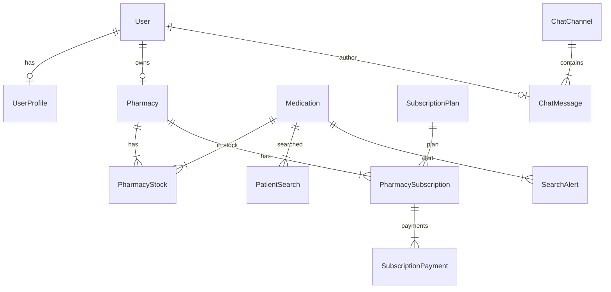
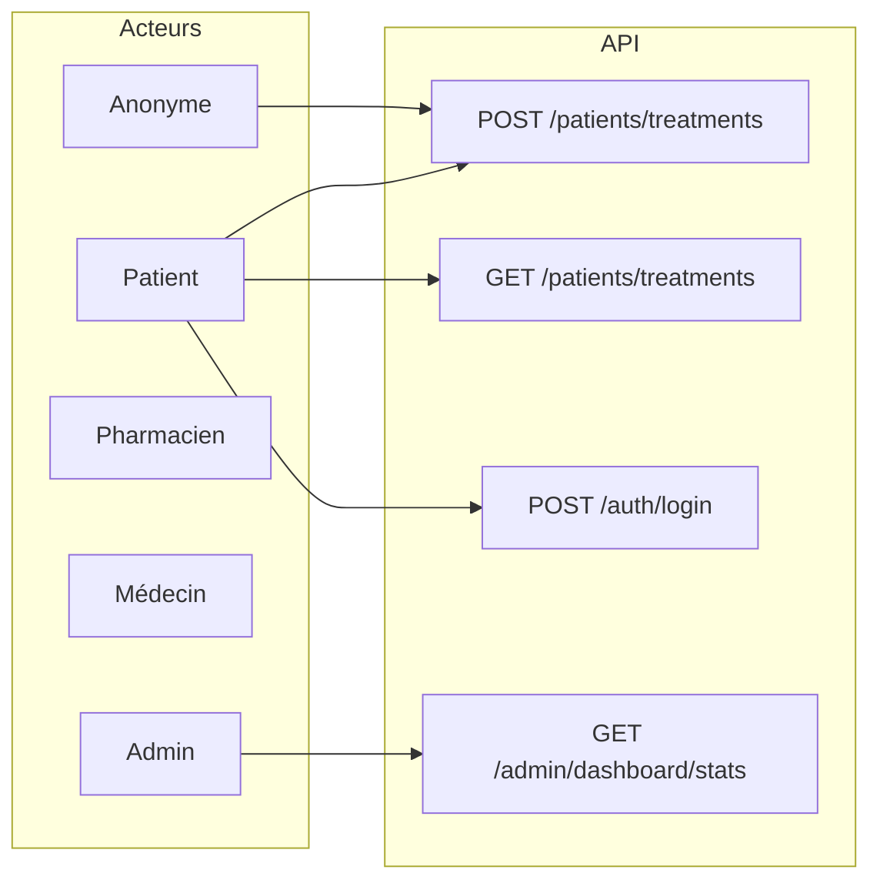

# Analyse UML – move4epilepsy-api

Document dérivé du code source de l’API (modèles, schémas, routes).  
Dernière mise à jour : Février 2025.

---

## 1. Diagramme de classes (entités et relations)

### 1.1 Paquetage `app.models` (persistance)

| Classe | Table | Attributs principaux | Relations |
|--------|--------|----------------------|-----------|
| **Base** | (declarative_base) | — | Héritée par tous les modèles |
| **User** | `users` | id (UUID), email, username, hashed_password, is_active, is_superuser, created_at, updated_at | 1→1 UserProfile, 0..1 Pharmacy |
| **UserProfile** | `user_profiles` | id, user_id (FK), username, role, first_name, last_name, phone, created_at, updated_at | 1→1 User |
| **Pharmacy** | `pharmacies` | id, pharmacy_id, name, license_number, address, city, department, commune, user_id (FK), active, … | 1→User, 1→* PharmacyStock, *→SubscriptionPlan via PharmacySubscription |
| **PharmacyStock** | `pharmacy_stocks` | id, pharmacy_id (FK), medication_id (FK), quantity, is_rupture, price, restock_delay, medication_name, … | *→1 Pharmacy, *→1 Medication |
| **Medication** | `medications` | id, name, dosage, form, active, created_at, updated_at | *→PharmacyStock, *→PatientSearch, *→SearchAlert |
| **PatientTreatment** | `patient_treatments` | id, name, age, sex, location, medication_name, dosage, frequency, treatment_start_date, treatment_end_date, treatment_is_ongoing, access_ease, effectiveness, found_medication, pharmacies_visited, … | (entité seule, pas de FK vers User) |
| **PatientSearch** | `patient_searches` | id, medication_id (FK), department, commune, search_timestamp, found_results, … | *→1 Medication |
| **SearchAlert** | `search_alerts` | id, medication_id (FK), department, commune, contact_email, is_active, … | *→1 Medication |
| **Alert** | `alerts` | id, type, medication_name, message, recipient_id, recipient_type, status, … | (entité seule) |
| **StockoutAlert** | `stockout_alerts` | id, medication_name, patient_location, status, … | (entité seule) |
| **SubscriptionPlan** | `subscription_plans` | id, name, country, monthly_price, annual_price, currency, features, max_stock_entries, is_active | *→PharmacySubscription |
| **CountryPricing** | `country_pricing` | id, country, currency, base_monthly_price, … | (entité seule) |
| **PharmacySubscription** | `pharmacy_subscriptions` | id, pharmacy_id (FK), plan_id (FK), status, start_date, end_date, auto_renew | *→1 Pharmacy, *→1 SubscriptionPlan, *→* SubscriptionPayment |
| **SubscriptionPayment** | `subscription_payments` | id, subscription_id (FK), pharmacy_id (FK), amount, currency, payment_method, status, paid_at | *→1 PharmacySubscription |
| **ChatChannel** | `chat_channels` | id, name, description, type, is_active | *→ChatMessage |
| **ChatMessage** | `chat_messages` | id, channel_id (FK), user_id (FK), content, is_deleted, is_reported | *→1 ChatChannel, *→1 User |
| **MessageReport** | `message_reports` | id, message_id (FK), reported_by (FK), reason, status | (lié à ChatMessage / User) |
| **UserOpinion** | `user_opinions` | id, author, content, rating, category, likes, dislikes | (entité seule) |
| **PartnershipApplication** | `partnership_applications` | id, organization_type, organization_name, contact_person, email, status, … | (entité seule) |
| **MedicineReport** | `medicine_reports` | id, medicament, pharmacy_name, address, price, quantity_status, reporter_name, verified | (entité seule) |
| **EpilepsyPerception** | `epilepsy_perceptions` | id, age_range, relationship_types, danger_level, normal_life, contagious, … | (entité seule) |

### 1.2 Schémas Pydantic (contrats API, non persistés)

- **PatientTreatmentCreate** / **PatientTreatmentResponse** : création / réponse traitement.
- **UserCreate** / **UserResponse**, **UserProfileCreate** / **UserProfileResponse** : auth / profil.
- **Token** : JWT (access_token, token_type).
- **TreatmentStats** : agrégats (total_treatments, average_effectiveness, common_medications, …).
- Schémas équivalents pour Pharmacy, Medication, Chat, Subscriptions, Opinions, etc.

### 1.3 Résumé des relations entre entités

- **User** ←→ **UserProfile** (1–1).
- **User** ←→ **Pharmacy** (0..1 par user).
- **Pharmacy** ←→ **PharmacyStock** (1–*).
- **Medication** ←→ **PharmacyStock** (1–*), **PatientSearch** (1–*), **SearchAlert** (1–*).
- **Pharmacy** ←→ **PharmacySubscription** (1–*).
- **SubscriptionPlan** ←→ **PharmacySubscription** (1–*).
- **PharmacySubscription** ←→ **SubscriptionPayment** (1–*).
- **ChatChannel** ←→ **ChatMessage** (1–*).
- **User** ←→ **ChatMessage** (0..*).

---

## 2. Cas d’usage (acteurs et fonctionnalités)

### 2.1 Acteurs

| Acteur | Description |
|--------|-------------|
| **Anonyme** | Pas de token JWT. |
| **Patient** | Utilisateur authentifié, rôle `patient`. |
| **Pharmacien** | Utilisateur authentifié, rôle `pharmacien` (lié à une Pharmacy). |
| **Médecin** | Utilisateur authentifié, rôle `medecin`. |
| **Admin** | Utilisateur authentifié, rôle `admin`. |

### 2.2 Cas d’usage par module

| Acteur(s) | Cas d’usage | Endpoint(s) |
|-----------|-------------|-------------|
| **Auth** | | |
| Anonyme, tout rôle | S’inscrire | POST /auth/register |
| Tous | Se connecter | POST /auth/login |
| Authentifié | Obtenir son profil / token | GET /auth/me, GET /auth/me/profile |
| Admin | Créer des utilisateurs de test | POST /auth/create-test-users |
| **Patients / Traitements** | | |
| Anonyme, tout authentifié | Enregistrer un traitement | POST /patients/treatments |
| Authentifié | Lister / filtrer traitements | GET /patients/treatments |
| Médecin (ou rôle autorisé) | Consulter les stats traitements | GET /patients/treatments/stats |
| Authentifié | Consulter / modifier un traitement | GET /patients/treatments/{id}, PUT /patients/treatments/{id} |
| **Médicaments** | | |
| Tous / Authentifié | Lister médicaments, détail, recherche | GET /medications, GET /medications/{id}, POST /medications/search |
| Admin / rôle autorisé | Créer / modifier médicament | POST /medications, PUT /medications/{id} |
| **Pharmacies** | | |
| Tous / Authentifié | Lister pharmacies, détail | GET /pharmacies, GET /pharmacies/{id} |
| Tous | Lister pharmacies avec stocks (public) | GET /pharmacies/public/pharmacies-with-stocks |
| Authentifié | Lister / ajouter stocks d’une pharmacie | GET /pharmacies/{id}/stocks, POST /pharmacies/{id}/stocks |
| **Recherche / Alertes** | | |
| Tous / Authentifié | Créer / lister / modifier / supprimer alerte | POST /alerts, GET /alerts, PUT /alerts/{id}, DELETE /alerts/{id} |
| **Chat** | | |
| Authentifié | Lister canaux, messages ; envoyer message | GET /chat/channels, GET /chat/channels/{id}/messages, POST /chat/channels/{id}/messages |
| Authentifié | Signaler / supprimer message ; créer canal | POST /chat/messages/{id}/report, DELETE /chat/messages/{id}, POST /chat/channels |
| **Abonnements** | | |
| Authentifié | Consulter plans, s’abonner, paiements | GET /subscriptions/plans, GET /subscriptions/plans/{id}, GET /subscriptions/my-subscription, POST /subscriptions/subscribe, POST /subscriptions/payments, PUT /subscriptions/payments/{id}/complete |
| Admin / rôle autorisé | Créer plan | POST /subscriptions/plans |
| **Opinions / Partenariats / Signalements / Perceptions** | | |
| Tous / Authentifié | CRUD avis, candidatures partenariat, signalements médicament, questionnaires perception | GET/POST /opinions, GET/POST/PUT /partnerships, GET/POST/PUT /medicine-reports, GET/POST /epilepsy-perceptions |
| **Admin** | | |
| Admin | Tableau de bord (stats globales) | GET /admin/dashboard/stats |
| Admin | Gestion utilisateurs (liste, rôle, activation) | GET /admin/users, PUT /admin/users/{id}/role, PUT /admin/users/{id}/activate |
| Admin | Modération messages / signalements médicaments | GET /admin/reports/messages, PUT /admin/reports/messages/{id}, GET /admin/reports/medicines |
| **Routing** | | |
| Tous / Authentifié | Calcul d’itinéraire (voiture) | GET /routing/directions/driving-car |

---

## 3. Diagrammes de séquence (flux principaux)

### 3.1 Enregistrement d’un traitement (création)

```
Participant: Client (Frontend / Postman)
Participant: API (FastAPI)
Participant: get_current_user_optional
Participant: get_db
Participant: PatientTreatment

Client -> API: POST /api/v1/patients/treatments + Body (PatientTreatmentCreate) [Bearer optionnel]
API -> get_current_user_optional: Résolution token (optionnel)
get_current_user_optional -> get_db: Session
alt token présent
  get_current_user_optional -> get_db: Query User + UserProfile par username (JWT)
  get_current_user_optional --> API: User ou None
else pas de token
  get_current_user_optional --> API: None
end
API -> API: Validation PatientTreatmentCreate (Pydantic), calcul treatment_duration si besoin
API -> get_db: Session
API -> PatientTreatment: Nouvelle instance (mapping champs)
API -> get_db: db.add(treatment); db.commit(); db.refresh(treatment)
get_db --> API: treatment persisté
API --> Client: 201 + PatientTreatmentResponse (JSON)
```

### 3.2 Authentification (login)

```
Participant: Client
Participant: API
Participant: OAuth2PasswordRequestForm
Participant: get_db
Participant: User (query by username)
Participant: Security (verify_password, create_access_token)

Client -> API: POST /api/v1/auth/login (form: username, password)
API -> OAuth2PasswordRequestForm: Parse body
API -> get_db: Session
API -> User: get_user_by_username(db, username)
User --> API: user ou None
alt user non trouvé
  API --> Client: 401 Invalid credentials
else user trouvé
  API -> Security: verify_password(plain, user.hashed_password)
  Security --> API: True/False
  alt mot de passe invalide
    API --> Client: 401 Invalid credentials
  else OK
    API -> Security: create_access_token(sub=username, expires_delta=...)
    Security --> API: JWT string
    API --> Client: 200 + Token(access_token, token_type="bearer")
  end
end
```

### 3.3 Consultation de la liste des traitements (dashboard / analytics)

```
Participant: Client (Frontend dashboard)
Participant: API
Participant: get_current_user_optional
Participant: get_db
Participant: PatientTreatment (query)

Client -> API: GET /api/v1/patients/treatments?skip=0&limit=1000 [Bearer optionnel]
API -> get_current_user_optional: Résolution token
get_current_user_optional --> API: User ou None
API -> get_db: Session
API -> PatientTreatment: query.filter(...).order_by(desc(created_at)).offset(skip).limit(limit)
PatientTreatment --> API: Liste d'instances
API -> API: Sérialisation List[PatientTreatmentResponse]
API --> Client: 200 + JSON array
```

### 3.4 Création d’une alerte de recherche

```
Participant: Client
Participant: API (search.router)
Participant: get_db
Participant: Modèle Alerte (table alerts ou search_alerts selon implémentation)

Client -> API: POST /api/v1/alerts + Body (création alerte)
API -> get_db: Session
API -> Modèle Alerte: Création instance + db.add + db.commit
API --> Client: 201 + AlertResponse
```

### 3.5 Admin – consultation du tableau de bord

```
Participant: Admin (Client)
Participant: API
Participant: get_current_user
Participant: require_admin
Participant: get_db
Participant: Modèles (User, PatientTreatment, Pharmacy, etc.)

Admin -> API: GET /api/v1/admin/dashboard/stats + Bearer (admin)
API -> get_current_user: Validation JWT → User
API -> require_admin: Vérification rôle admin
alt non admin
  API --> Admin: 403
else
  API -> get_db: Session
  API -> Modèles: Agrégations (counts, stats)
  Modèles --> API: Données brutes
  API -> API: Construction DashboardStats (Pydantic)
  API --> Admin: 200 + JSON (stats dashboard)
end
```

---

## 4. Diagrammes Mermaid (optionnel)

### 4.1 Classes (extrait)



### 4.2 Cas d’usage (extrait)



---

*Document généré à partir du code de `app/models`, `app/schemas`, `app/api/v1` et `app/core/dependencies`.*
